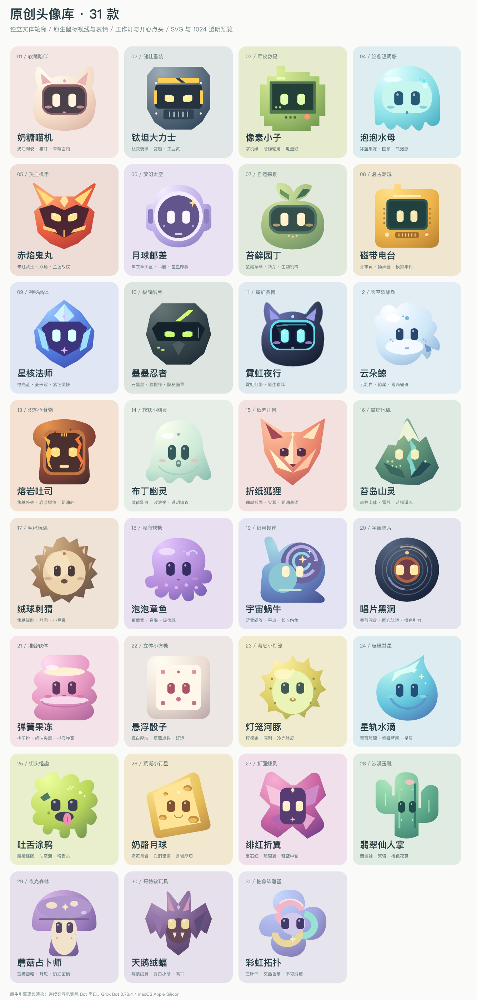

# Grok Bot 头像工具

给 Grok Bot 换上原创头像：**31 款动态角色 + 11 款虚拟人物头像，共 42 款**。每个独立 Bot 都能在自己的头像窗口选择，并分别记住选择。

**[下载 macOS Apple Silicon 完整包](https://github.com/BTCUP99/grok-bot-avatar-tool/releases/download/v1.4.3/GrokBotAvatarTool-1.4.3-macOS-arm64.zip)** · [版本说明与其他下载](https://github.com/BTCUP99/grok-bot-avatar-tool/releases/tag/v1.4.3) · [报告兼容问题](https://github.com/BTCUP99/grok-bot-avatar-tool/issues)

当前发布为 **v1.4.3 社区预览版**。完整包自带 Node.js，解压后双击启动，无需安装开发环境。请下载名称带 **macOS-arm64** 的 ZIP；GitHub 自动生成的 Source code 压缩包只包含源码。

## 头像展示

### 31 款原创动态角色



### 11 款虚拟人物头像

这 11 款也已包含在完整包中，均为维护者生成的非真人图像。不同 Bot 可以分别选择动态角色或人物头像。

下方为静态预览，点击可查看原图。在 Bot 窗口中，人物头像支持 **整图轻倾斜、悬停转正、移开回位、工作柔光与完成轻弹**，五官和表情保持原样。

<table>
  <tr>
    <td align="center"><a href="runtime-bean/photos/fragrance.png"></a><br>香氛街区</td>
    <td align="center"><a href="runtime-bean/photos/lotus.png"></a><br>江南贵女</td>
    <td align="center"><a href="runtime-bean/photos/designweek.png"></a><br>设计周广场</td>
    <td align="center"><a href="runtime-bean/photos/metro.png"></a><br>地铁广场</td>
  </tr>
  <tr>
    <td align="center"><a href="runtime-bean/photos/skywalk.png"></a><br>空中连廊</td>
    <td align="center"><a href="runtime-bean/photos/park.png"></a><br>公园日常</td>
    <td align="center"><a href="runtime-bean/photos/citynight.png"></a><br>城市夜色</td>
    <td align="center"><a href="runtime-bean/photos/flowerfield.png"></a><br>山野花田</td>
  </tr>
  <tr>
    <td align="center"><a href="runtime-bean/photos/sunnybeach.png"></a><br>海滩晴蓝</td>
    <td align="center"><a href="runtime-bean/photos/seabreeze.png"></a><br>海风白裙</td>
    <td align="center"><a href="runtime-bean/photos/lakecafe.png"></a><br>湖畔咖啡</td>
    <td></td>
  </tr>
</table>

选择入口：**对话详情 → 点击头像 → 写真头像 → 应用头像**。

## 支持范围

| 项目 | 当前支持 |
| --- | --- |
| 系统 | macOS，Apple Silicon / M 系列芯片 |
| 官方客户端 | Grok Bot **0.78.4、0.78.5、0.79.4** 的已核验构建 |
| 安装位置 | `/Applications/Grok Bot.app` |
| 选择范围 | 每个独立 Bot；群组使用官方头像编辑器 |
| 保存范围 | 当前工具目录的本机配置，不修改云端头像 |

Windows、Linux、Intel Mac 和其他客户端版本暂不支持。工具会检查版本、架构、官方签名与文件哈希，不匹配时停止加载。

## 下载后怎么用

1. 从上方链接下载 **macOS-arm64 完整包**，解压到固定目录，保留全部子目录。
2. 首次先正常打开官方 Grok Bot，登录并等待 Bot 列表同步，然后用 **Command-Q 完全退出**。
3. 双击解压目录中的 **`启动头像工具.command`**。如果官方客户端仍在运行，工具会提示先退出，再点“启动 Grok Bot”。
4. 在任意独立 Bot 中打开 **对话详情 → 点击头像**，进入 **原创动态头像** 或 **虚拟人物头像**（界面标签为“写真头像”），选款式后点 **应用头像**。
5. 以后仍双击同一个启动文件。各 Bot 的选择会分别保留，无需上传图片或输入 Bot ID。

从普通官方图标启动不会加载原创头像；再次通过工具启动会恢复本机选择。工具运行时再次双击启动文件会回到现有窗口。若 macOS 提示无法验证下载内容，请先确认来源，再按系统提供的审查流程处理；无需关闭系统安全防护。

## 头像能做什么

- **动态角色**：保留原生转头、眨眼和表情；鼠标到中心转正、移开回位；工作时亮状态灯，完成时显示开心与一次点头。
- **虚拟人物**：整张图轻微倾斜，悬停转正、移开回位；工作时柔光、完成时轻弹；不生成新的面部角度、眨眼或嘴型。
- **每个 Bot 独立**：选择、恢复和状态反馈按 Bot 区分。选图先暂存，点击应用才保存；取消保持原样。
- **官方选项保留**：原有上传、生成、默认形状入口仍在“官方选项”标签中，继续按官方规则工作。

31 款角色含奶糖喵机、霓虹夜行、云朵鲸、布丁幽灵、宇宙蜗牛、彩虹拓扑等。11 款虚拟人物为维护者自行生成的非真人图像。完整清单、尺寸与动作参数见 [头像库使用说明](runtime-bean/头像库使用说明.md)，创作规范见 [头像制作规范](runtime-bean/头像制作规范.md)。

## 客户端更新与维护

**本工具依赖特定版本的客户端内部结构。Grok Bot 更新后，包括小版本更新，工具也可能暂时不可用。** 当前可以使用不代表后续版本一定兼容；不要删除版本、签名或哈希检查来强行运行。

遇到不兼容时，先查看 [发行版](https://github.com/BTCUP99/grok-bot-avatar-tool/releases) 是否有新版；也可以在 Issues 中提供客户端版本、Mac 芯片与去除个人信息后的错误提示。维护者会尽量及时跟进已确认的兼容问题，完成检查后发布适配版本。没有自动更新或固定修复时限的保证。

更新本工具时，保留原目录的 `runtime-bean/config.local.json`。如果解压到新目录，将该文件复制过去即可沿用选择；它包含本机 Bot ID，**不要上传或放进分享包**。

## 恢复与卸载

恢复某个 Bot：在它的头像选择窗口点 **恢复原头像**。临时全部恢复：Command-Q 完全退出，再从官方图标正常打开。卸载：退出后移走本工具目录即可。官方 App 文件和代码签名始终不改动。

## 开源、开发与验证

工具代码、原创程序化角色、维护者提供的虚拟人物示例和项目文档按 [MIT](LICENSE) 许可发布。官方客户端不包含在仓库和下载包中，也不属于本项目的许可范围。完整版中的 Node.js 保留原始许可，详见 [第三方组件说明](THIRD_PARTY_NOTICES.md) 与 [虚拟人物素材说明](runtime-bean/photos/README.md)。

源码需要 Node.js 22+；本机打包另需 Python 3。没有 npm 运行时依赖。

```sh
npm run test:portable   # 无需安装 Grok Bot；供 GitHub CI 使用
npm test                # 需在受支持的 Apple Silicon Mac 上安装已核验官方客户端
npm run prepare:runtime
npm run package
npm run test:package
```

项目保留 `runtime-bean/` 与 `avatar-designs/` 的既有结构；发布内容由显式白名单生成。源码入 Git，完整包和源码包放 GitHub Releases。开发与发布流程见 [贡献指南](CONTRIBUTING.md)、[发布检查](docs/RELEASING.md)、[更新记录](CHANGELOG.md) 和 [安全说明](SECURITY.md)。

0.79.4 已通过本机官方引擎回归及官方界面组件的隔离验证：42 款选择、两 Bot 独立操作、11 款人物在 36/64 px 的 44 次转正/回位观察、31 款动态角色渲染、工作与完成状态反馈，以及选择后渲染器重载恢复。**本轮未重新完成当前账号的原生窗口退出重启与真实任务端到端验收。** GitHub CI 的 portable 检查不能替代这些本机测试，因此本次作为社区预览版发布。

## 非官方声明

本项目与 **Grok Bot 官方无关**，是独立维护的社区开源测试工具，不由官方开发、维护或背书。Grok Bot 及相关名称、标识的权利归其各自权利人所有。本项目仅供社区测试、交流与研究使用；不提供官方支持，也不承诺始终兼容未来的客户端版本。
